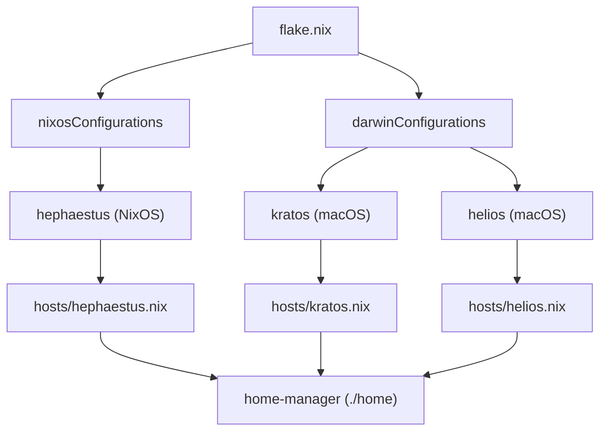

# nix-config

This repo stores nix configuration to manage my hosts running [NixOS](https://nixos.org/) and macOS.

The configuration is very specific to my own machines and setup, but it may be a useful reference for anyone else learning or experimenting with nix, whether it be on a personal workstation or a server environment.



## Prerequisites

- [NixOS](https://nixos.org) (Linux)
- [Determinate Nix](https://determinate.systems/nix-installer) (macOS)
- [just](https://github.com/casey/just)

## Build

To run a build/rebuild:

```sh
just rebuild
```

## Updates

Run `just update` to bump the flake inputs and the prebuilt tools, review the diff, then run `just rebuild`.

The agent skill inputs are bumped separately with `just update-skills`; review the upstream diff before rebuilding. GitHub Actions pins are updated by hand.

## Common Recipes

Run `just` to view the current recipes and their descriptions.


