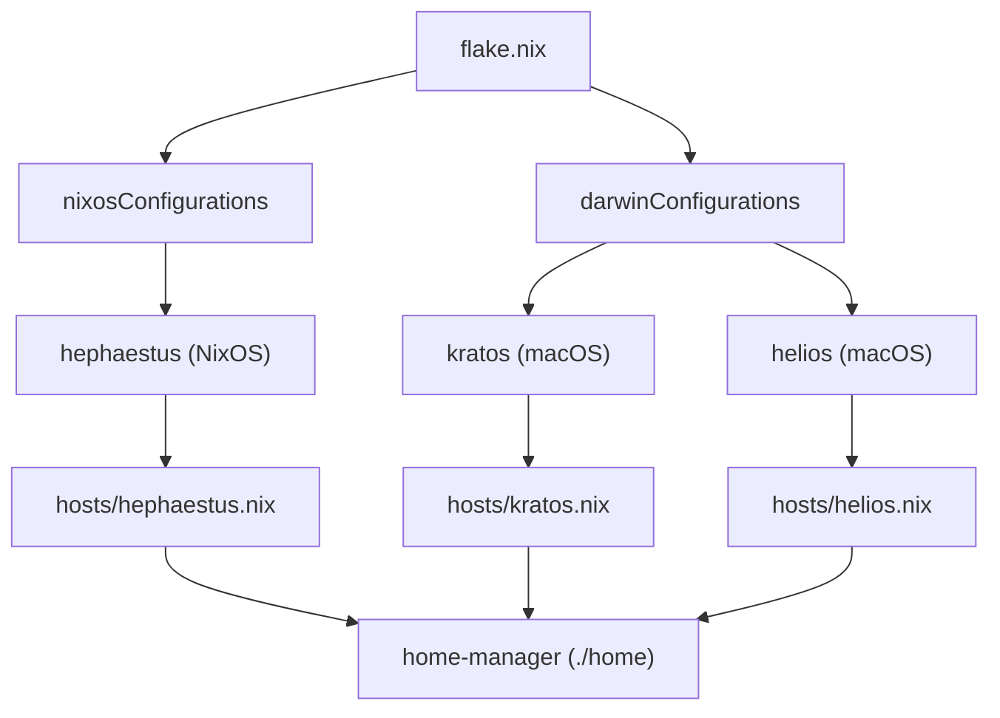

# nix-config

This repo stores nix configuration to manage my hosts running [NixOS](https://nixos.org/) and macOS.

The configuration is very specific to my own machines and setup, but it may be a useful reference for anyone else learning or experimenting with nix, whether it be on a personal workstation or a server environment.



## Prerequisites

- [NixOS](nixos.org) (Linux)
- [Determinate Nix](https://determinate.systems/nix-installer) (macOS)
- [just](https://github.com/casey/just)

## Build

To run a build/rebuild:

```sh
just rebuild
```

## Updates

Updates are proposed by [renovate](https://github.com/renovatebot/renovate). To build the system, checkout the renovate PR and run `just rebuild`.

If the build is stable, run `just merge-pr`.

## Common Recipes

Run `just` to view the current recipes and their descriptions.


